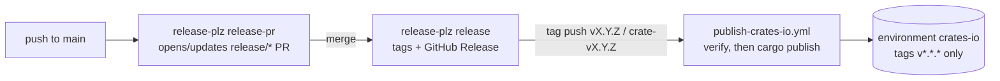

# Release automation (release-plz, tag-driven publishing)

This is the **release-plz mode**. For apps, Git Flow repos and shared-version workspaces,
see the GitVersion mode in `docs/versioning.md`. The SemVer, tag-trigger, environment and
trusted-publishing rules below apply to both modes.

Here: **release-plz in git-only mode** plus a **tag-triggered publish workflow**. Releases
cut by a human (tags, cargo-release) belong to the GitVersion mode (see the end of this file).

## Flow



1. On every push to the main branch, `release-plz release-pr` opens or updates a PR on a
   `release/...` branch (`pr_branch_prefix`), titled "Release v1.2.3" instead of release-plz's
   default "chore: release v1.2.3" (`pr_name`).
   - The PR bumps each changed crate's version and updates its `CHANGELOG.md`.
   - The bump comes from imperative commit verbs (`custom_minor_increment_regex`), and
     cargo-semver-checks escalates it to major when the API breaks.
2. Merging that PR runs `release-plz release`. With `git_only = true`, release-plz reads
   versions from git tags instead of crates.io. It creates the tags and one GitHub Release
   per tag, with the changelog as the body. It never runs `cargo publish`.
3. The tag push starts `publish-crates-io.yml`:
   1. The `verify` job re-runs clippy and the tests on the tagged commit.
   2. Then the `crates-io` job publishes that one crate. It runs in the `crates-io`
      environment, which only accepts `v*.*.*` / `*-v*.*.*` tags (`docs/github.md`), and
      uses trusted publishing (`rust-lang/crates-io-auth-action`, no stored token).
4. Other targets (npm for a wasm package, web deploys) get their own job and environment
   in the same pattern.

Tags and PRs are created with a GitHub App token. Events created with `GITHUB_TOKEN` do not
trigger other workflows, so publishing would never start and CI would not run on release PRs.

**A failed publish leaves the tag in place.** git-only mode then treats the version as
released. Fix the cause and re-run the failed `publish-crates-io.yml` job. Do not delete and recreate
the tag.

## Versioning

All versions are **SemVer 2.0** (as Cargo implements it): `MAJOR.MINOR.PATCH`, optionally
with a pre-release (`1.2.0-rc.1`). Do not use build metadata (`+...`), because crates.io
ignores it for version identity.

- Pre-1.0 crates follow Cargo's rule: in `0.x`, the minor number is the breaking position.
- Pre-releases publish normally. Their tags match the workflows' `-*` filters and the
  environments' `v*.*.*` policy. `git_release_type = "auto"` marks their GitHub Releases as
  pre-releases.
- Set a pre-release with `release-plz set-version <crate>@1.2.0-rc.1` (or edit the version
  in the release PR).

## Tags and multiple crates

- One public crate: tag `vX.Y.Z`. In `publish-crates-io.yml`, replace `__CRATE__` with its name.
- Several public crates: tag `<crate>-vX.Y.Z` per crate, each crate versioned independently.
  Override `git_tag_name` per `[[package]]` if the main crate should keep plain `vX.Y.Z`.
  `publish-crates-io.yml` maps `vX.Y.Z` to that crate.
- Separate versions need separate `version` fields. If the members use
  `version.workspace = true`, ask the user. Either move to per-crate versions (copy the
  current value into each member), or keep a shared version deliberately; in that case, set
  `version_group` to release the crates together.
- Unpublished members: set `publish = false` in `Cargo.toml`. In git-only mode, release-plz
  still tags them. Add `release = false` in `release-plz.toml` when they should not be tagged.
- Each publishable crate needs `description`, `license`, `repository`, `readme`, `keywords`
  and `categories` (`docs/metadata.md`).
- **Name check:** `scripts/trusted-publishing.py` reports when a crate name is already taken
  on crates.io by another repository. Ask the user to rename the crate before the first
  release.

## Commit style and changelog

Commits use imperative mood (`docs/github.md`). `templates/release-plz.toml` sets:

- `commit_parsers` maps leading verbs to changelog groups: Add/Introduce go to Added,
  Fix/Correct to Fixed, Remove/Drop to Removed, Deprecate to Deprecated, Bump to
  Dependencies. Everything else goes to Changed.
- `custom_minor_increment_regex` makes the same "Add..." verbs a minor bump.
  `custom_major_increment_regex` reacts to a `BREAKING CHANGE:` line in the body. semver-checks
  catches API breaks either way.
- If CONTRIBUTING.md defines Conventional Commits instead, drop the custom regexes and the
  parsers. release-plz's defaults handle Conventional Commits.

Changelog hygiene:

- release-plz assigns every commit that touches a crate's files to that crate's changelog,
  infra commits included. Keep repo-infrastructure changes in commits that do not touch crate
  sources where practical.
- Review the release PR's changelog before merging. It is a normal file in the PR and can be
  edited there.

Verify the config when release-plz is installed. `release-plz update` has no dry-run, so
run it on a throwaway branch:

```sh
git switch -c tmp/release-check && release-plz update && git diff --stat
git restore . && git switch - && git branch -D tmp/release-check
```

`release-plz release --dry-run` checks the release step.

## GitHub App (one-time, reusable across repos)

1. Go to Settings, Developer settings, GitHub Apps, New GitHub App. Uncheck Webhook
   "Active". Set the repository permissions:
   - **Contents**: Read and write.
   - **Pull requests**: Read and write.
   - **Administration**: Read and write, only if tags are protected by a ruleset.
2. Generate a private key, and install the App on the repo (or on all repos).
3. Store the App's **Client ID** as the variable `RELEASE_APP_CLIENT_ID`, and the private key
   as the secret `RELEASE_APP_PRIVATE_KEY` (repo or org level).
   `actions/create-github-app-token@v3` takes `client-id`; `app-id` is deprecated.
4. In the repo, go to Settings, Actions, General, and allow GitHub Actions to create and
   approve pull requests.

The workflow scopes each minted token with `permission-*` inputs (zizmor `github-app`).
The alternative is a fine-grained PAT. Offer it only if the user refuses an App, because it
is long-lived and tied to one person.

## Git Flow

release-plz's release PR always targets the default branch, so in Git Flow:

- Delete the `release-plz-pr` job, and keep `release-plz-release` running on `main`.
- To cut a release:
  1. `git switch -c release/<version> develop`.
  2. `release-plz update` (bumps the versions and changelogs locally).
  3. Commit "Release <version>", then open a PR into `main`.
- Merging into `main` runs `release-plz release`: tags and GitHub Release, then publish.
  Afterwards, merge `main` back into `develop`.
- Hotfixes: `hotfix/<version>` from `main`, the same `release-plz update` step, a PR into
  `main`, then a back-merge.

## Workflow details

- Checkout uses `fetch-depth: 0` (release-plz needs history) and `persist-credentials: false`.
  release-plz pushes through the GitHub API.
- `if: github.repository_owner == '...'` stops forks from running release jobs.
- The `release` job has no concurrency group. The PR job uses one without cancellation.
- Workflow names: one `publish-<target>.yml` per registry, each with an environment of the
  same name: `publish-crates-io.yml` with `crates-io`, and later `publish-npm.yml` with `npm`
  for a wasm package. Binaries go in `release-binaries.yml` (`docs/binaries.md`).
- Do not rename a publish workflow or its environment casually. crates.io trusted publishing
  is bound to both.
- **Existing repo with a different publish workflow** (for example `release.yml`): keep its
  name if trusted publishing already points at it. To migrate, rename the file, add the new
  trusted-publishing config, check that a release works, and only then delete the old
  config. Doing it in that order keeps a working path at every step.

## Human-driven releases

If a human should cut releases, for example with cargo-release, use the **GitVersion mode**
(`docs/versioning.md`). It provides `task release:tag`, and `task release:cargo` for
committed versions. The version then always comes from GitVersion. release-plz is for
bot-driven releases only.

Sources: https://release-plz.dev/docs/config (git_only, publish, pr_branch_prefix, pr_name,
custom_*_increment_regex, commit_parsers), https://release-plz.dev/docs/github/quickstart,
https://release-plz.dev/docs/github/token, https://release-plz.dev/docs/usage/release-pr
