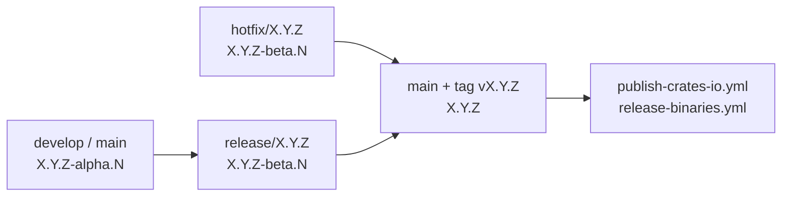

# Versioning modes: release-plz or GitVersion

All versions are SemVer 2.0 (`docs/release.md`, Versioning). *How* the next version is
found differs by project, so ask with AskUserQuestion and recommend by the repo's shape:

| Mode | Fits | Version source | Pre-releases | Stable |
|---|---|---|---|---|
| **release-plz** | Libraries on crates.io; several separately versioned crates; GitHub Flow | Commit verbs plus semver-checks, written to `Cargo.toml` by the release PR | Only on request (`set-version`) | Tag that release-plz creates when its PR is merged |
| **GitVersion** | Apps, services, binaries and Docker images; Git Flow; one shared version | Branch type and the last tag, computed in CI by GitVersion | Every CI build: `-alpha.N` on `develop` (Git Flow) or `main` (GitHub Flow), `-beta.N` on `release/*` and `hotfix/*` | A `vX.Y.Z` tag on `main` |

**The switching point is who decides the version, and when.**

- If a bot should derive it from commits, use release-plz. A merged release PR releases,
  with no human release step.
- If a human cuts releases, use GitVersion. That covers a tag, `cargo release`, or a Git
  Flow release or hotfix branch. GitVersion computes the same number locally and in CI, so
  a human-driven release always takes its version from GitVersion and never invents one.

Mixing both in one repo does not work: two tools would own the version. Pick one per repo.

## GitVersion mode



**Config:** use `templates/gitversion/GitVersion.gitflow.yml` or
`templates/gitversion/GitVersion.githubflow.yml` as `GitVersion.yml`.

- Both use the **GitVersion 7** configuration format (`calculation:` / `output:`) and were
  checked with GitVersion 7.0.0.
- Git Flow (`GitFlow/v1`) gives:
  - `develop`: `1.2.0-alpha.0`;
  - `release/1.1.0`: `1.1.0-beta.3`;
  - `hotfix/1.0.1`: `1.0.1-beta.1`;
  - tagged `main`: `1.0.1`;
  - feature branches: their own label (`1.2.0-thing.1`).
- GitHub Flow (`GitHubFlow/v1`, with `main` labelled `alpha` and an explicit `hotfix` branch
  rule) gives:
  - `main`: `1.0.1-alpha.1`;
  - `hotfix/1.0.1` and `release/1.1.0`: `-beta.1`;
  - a tag: stable.
- **Repos on GitVersion 6** (v6 config format, `workflow:` and `branches:` at the top level):
  keep them pinned to `6.x`. GitVersion 7 rejects the v6 format. Migrate with
  `dotnet-gitversion config migrate --in-place`, then raise the pin.

**CI:** compute the version once per job that builds an artifact:

```yaml
      - uses: actions/checkout@v7
        with:
          fetch-depth: 0              # GitVersion needs the history and the last tag
          persist-credentials: false
      - uses: gittools/actions/gitversion/setup@v5
        with:
          versionSpec: '7.0.x'
      - uses: gittools/actions/gitversion/execute@v5
        env:
          DO_NOT_TRACK: '1'           # GitVersion 7 sends sampled CLI telemetry otherwise
      - name: Stamp the version
        run: |
          sh scripts/zero-version.sh
          cargo set-version "$(sh scripts/ci-version.sh)"
        env:
          BRANCH_FLOW: gitflow          # or github; same value as in the Taskfile
```

**Pull-request builds:** by default GitVersion labels them `X.Y.Z-PullRequest12.3`.
`scripts/ci-version.sh` turns that into the label of the PR's *target*:

- a PR into `develop` (or `main` in GitHub Flow) becomes `X.Y.Z-alpha.N`;
- a PR into `release/X.Y.Z` or `hotfix/X.Y.Z` (or `main` in Git Flow) becomes
  `X.Y.Z-beta.N`, taking `X.Y.Z` from the branch name.

Crate versions never carry build metadata. `--informational` adds `+PullRequest12` for
human-facing strings, such as `--version` output or image labels. Outside PRs the script
prints GitVersion's `SemVer` unchanged. Do not set the `pull-request` label to `~` to
inherit labels: that crashes GitVersion 7 on PRs into release branches ("'BranchName' is not
a valid placeholder").

Pin the actions with `scripts/pin-actions.py`. It creates the env vars `GitVersion_SemVer`,
`GitVersion_FullSemVer` and `GitVersion_InformationalVersion` (plus the step outputs).

**Why `zero-version.sh` first:** `cargo set-version` (cargo-edit) refuses to move a version
"backwards". It compares pre-release identifiers as strings, so a CI version like
`1.4.0-PullRequest12.3` sorts below the committed `1.4.0-alpha`, and the stamp fails with
"Cannot downgrade". The script resets `[workspace.package]` (or `[package]`) to `0.0.0`,
so every stamp is an upgrade. This is a known upstream issue in cargo-edit, not a
misconfiguration. Copy the script to `scripts/`.

**Committed version:** keep `version` in `[workspace.package]`, with every member on
`version.workspace = true`. One shared version is the point of this mode. Set it to the next
version's pre-release, for example `1.5.0-alpha`, so local builds sort correctly. Bump it
when a release branch is cut.

**Releasing:**

1. Git Flow: create `release/X.Y.Z` from `develop` (or `hotfix/X.Y.Z` from `main`) and
   stabilize it there. Every build is `X.Y.Z-beta.N`.
2. Merge it into `main` (and back into `develop`). Then tag with `task release:tag`. It
   prompts before tagging. It reads `MajorMinorPatch` from GitVersion, so the tag is the
   stable `vX.Y.Z` even on GitHub Flow's `-alpha` main. Tag from `main`, or straight from a
   `release/*` or `hotfix/*` branch. `task release:tag PRE=1` tags the pre-release instead
   (`vX.Y.Z-beta.N`).
   - Never create the tag with the workflow `GITHUB_TOKEN`, for example via
     `gh release create` in a workflow: such a tag does not trigger the publish workflows.
     Tag locally, or with an App token.
   - **cargo-release** (optional, only when the released version should also be committed
     to `Cargo.toml`): `templates/gitversion/release.toml` and `task release:cargo`. The
     task commits GitVersion's `MajorMinorPatch` on the release or hotfix branch. It works
     around the same "cannot downgrade" bug that cargo-release shares with cargo-edit: it
     runs `zero-version.sh`, then `cargo set-version`, then `cargo release commit`. Plain
     `cargo release <version>` fails, and `cargo release replace` refuses the dirty tree, so
     pre-release replacements are unavailable on this path. That
     branch is not protected like `main`. The task commits "Release X.Y.Z" without tagging
     or pushing. Tag `main` with `task release:tag` after the merge.
   - `task version` prints what GitVersion computes for the current commit.
3. The tag runs `publish-crates-io.yml`, applied from `publish-crates-io.gitversion.yml`. It
   stamps the tag's version and publishes every publishable crate, skipping versions that
   are already on crates.io. It also runs `release-binaries.yml`, which stamps the version
   before building.
4. Pre-release tags (`vX.Y.Z-beta.N`) publish the same way, if the user wants
   pre-releases on crates.io. Otherwise beta builds stay CI artifacts.

**Changelog:** there is no release-plz in this mode.

- Assemble `CHANGELOG.md` at release time from the merged PRs, for example with
  `gh release create --generate-notes` or a script over the PR descriptions.
- Then every PR description needs a "what changed and why" section. Add that rule to the
  review topics and the PR template.

**Release binaries / Docker:** add the GitVersion steps above to `release-binaries.yml`
before the build, so binaries carry the stamped version. For Docker images, tag them with
`GitVersion_SemVer`.

Sources: https://gitversion.net/docs/reference/configuration,
https://github.com/GitTools/actions (gitversion/setup, gitversion/execute, v5 ships
GitVersion 7), https://github.com/killercup/cargo-edit (set-version).
